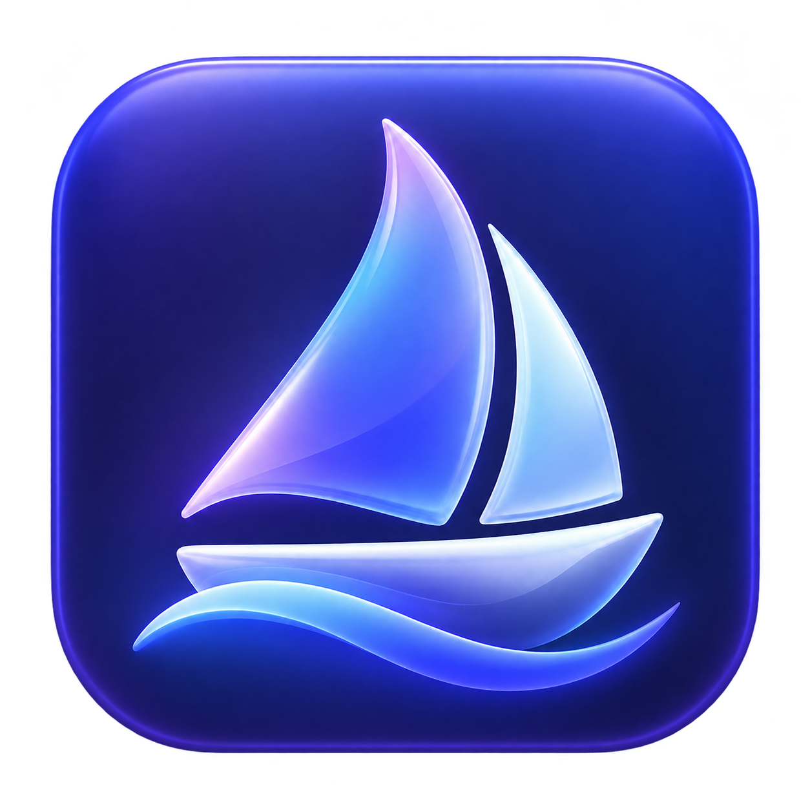

  

# Vela — Wine Manager for macOS

**A native Wine manager for macOS, built with SwiftUI and Rust.**

Create separate Windows environments, connect your preferred Wine engines, and launch Windows applications from a focused macOS interface.

[Support development](https://boosty.to/axira_dev/donate) · [Contributing](CONTRIBUTING.md) · [Roadmap](docs/roadmap.md) · [Russian README](README.ru.md)

## Project status

Vela 0.4.1 is an early preview for Apple Silicon. The interface supports English and Russian and follows your device languages by default. The primary project documentation is in English.

The app and source archives do **not** include a Wine engine. A compatible engine must be installed separately. Experimental ARM64/FEX support has been validated locally with a small x64 test program; compatibility with individual Windows applications varies.

## Features

- Install game launchers from a built-in catalog: download the official installer, create an environment, and detect its shortcut.
- Delete environments with confirmation, restore them from Vela Trash, or permanently remove their files.
- Choose English, Russian, or System default for the interface language.
- Register multiple Wine engines and keep environments tied to a specific engine.
- Create separate 64-bit Wine environments with their own Windows files and registry.
- Launch EXE and MSI files; save shortcuts, arguments, and working directories.
- Launch BAT and CMD files through the Windows command processor.
- Open Wine configuration, Registry Editor, the Windows console, and the uninstaller.
- Set per-environment variables, including DLL overrides and Wine debugging options.
- Adjust Windows interface scaling from 100% to 300%; new environments default to 200% on Retina displays.
- View operation logs and stop the selected environment.
- Inspect engine architecture and distinguish native ARM64 engines from Intel engines that require Rosetta on Apple Silicon.
- Support development through an optional Boosty link.

The manager uses atomic state-file replacement and serializes concurrent writes. Launching an application does not block the main interface.

## Requirements

| Component | Requirements and current validation |
| --- | --- |
| Vela application | Apple Silicon; deployment target macOS 14.0 or later |
| Tested system | Apple M1 running macOS 26.5.2 |
| Experimental native Wine/FEX runtime | Apple Silicon, macOS 26.5 or later; 64-bit Windows applications only |
| Intel Wine on Apple Silicon | A compatible Intel Wine build and Rosetta |
| Build tools | Rust/Cargo, Swift 6, and Xcode or Command Line Tools |

Older macOS versions within the app's deployment target have not been validated. Wine engines may require a newer system than the Vela interface.

The current binary is built for Apple Silicon. An Intel build and an Intel Mac test matrix are not provided.

## Get started

### Preview application

1. Download `Vela-0.4.1-preview.zip` from the [Releases page](https://github.com/AxiraDev/Vela/releases).
2. Extract `Vela.app` and place it in a writable location.
3. Open Vela and add a compatible Wine application bundle, runtime directory, or `wine` executable.
4. Create an environment and wait for initialization to finish.
5. Open a Windows installer or executable. After installation, add a shortcut to the installed application.

Preview builds are locally signed with an ad hoc signature. Developer ID signing and Apple notarization are not configured.

### Choose a Wine engine

Vela checks the engine version and looks for its matching `wineserver`. Keep each engine's directory intact.

Engine selection shows **Windows apps: 32-bit and 64-bit**, **64-bit only**, or **32/64-bit support unverified** prominently. A separate line identifies the Mac engine as **Apple Silicon (ARM64)** or **Intel (x86_64)**, with its Rosetta requirement. These describe different things: a 64-bit Intel Mac engine can support both 32-bit and 64-bit Windows applications through WoW64.

Explicit runtime capability metadata takes priority. For Intel builds without a capability declaration, Vela inspects the expected 32-bit and 64-bit Windows/WoW64 module headers. Architecture alone is not treated as evidence of 32-bit support. In the launcher installation sheet, engines known to lack required 32-bit support are shown but cannot be selected.

[Gcenx macOS Wine builds](https://github.com/Gcenx/macOS_Wine_builds/releases) are one separately maintained source of macOS binaries. The Intel build used during validation requires Rosetta on Apple Silicon.

The experimental ARM64/FEX configuration is documented in [Native runtime notes](docs/native-runtime.md). Its binaries are not included in this release. Do not interpret the native engine support as an automatic engine installer.

Adding an ARM64 engine does not convert existing Intel environments. Create a new environment for a different engine.

### Install a game launcher

Open **Игровые лаунчеры** (Game launchers), select a launcher, choose a Wine engine, and click **Скачать и установить** (Download and install). Vela downloads the Windows installer directly from the publisher, creates a separate environment, and opens the installation wizard. Finish the wizard yourself. When the expected client executable appears, Vela adds its shortcut automatically.

The catalog includes Steam, Epic Games Launcher, GOG GALAXY, Battle.net, EA app, Ubisoft Connect, Rockstar Games Launcher, Amazon Games, itch.io, and Wargaming Game Center (EU). Riot Client has an information card only because games requiring Vanguard cannot run through Wine. The catalog is curated rather than an exhaustive list of every launcher.

Many installers require 32-bit Windows support even when the client itself is 64-bit. Vela blocks known incompatible engine choices. The experimental 64-bit-only native engine cannot install these 32-bit bootstrappers. There is no automatic switch to an Intel engine.

If a download address changes, use **Выбрать скачанный файл…** (Choose downloaded file) with the official installer. Vela still creates the environment for you. Custom installation paths may require adding the shortcut manually. Launcher and game compatibility has not been established by inclusion in the catalog. See [Launcher catalog](docs/launcher-catalog.md).

### Delete or restore an environment

Open the environment's **Settings** tab and click **Delete environment…**, or right-click it in the sidebar. Vela stops that environment's Windows programs and moves its library entry to **Vela Trash**. Unsaved application changes may be lost.

Open Vela Trash to restore it with its files, shortcuts, and settings, or choose **Delete permanently…** to free disk space. Permanent deletion removes that environment's prefix, cached installers, and operation logs. Wine engines and files outside the environment are kept. Soft deletion keeps files in their original location until permanent deletion; it is separate from the macOS Trash.

### Interface language

Open **App settings** in the sidebar or **Vela → Settings…**. **System default** follows your preferred device languages, with English as the fallback when none is supported. You can select English or Russian explicitly. Changes apply immediately and persist after restart. This controls Vela's interface; Wine and Windows applications manage their own languages.

### Windows interface size

Set the Windows scale in an environment's settings. Restart its Windows applications after changing the scale. Changing the setting does not forcibly close running applications.

## How it works

SwiftUI provides the interface. A separate Rust executable, `vela-core`, handles engine registration, environment creation, process launch, configuration, and logs.

The interface sends one JSON request to the core over standard input and receives one JSON reply. The core launches the selected Wine engine with the selected environment's `WINEPREFIX`. Wine implements Windows APIs; FEX, where supported, translates Windows x64 instructions on ARM64.

See [Architecture](docs/architecture.md) and [Validation](docs/validation.md).

## Data and environments

The default library location is:

~~~text
~/Library/Application Support/Vela/
├── state.json
├── prefixes/
├── installers/
└── logs/
~~~

Each environment contains its Windows drive, registry, installed applications, and data.

For an optional library beside the application, copy `Portable.example` to a file named `Portable` next to `Vela.app`. The library will then use the adjacent `Data/` directory. This does not migrate an existing library. macOS folder permissions still apply.

Developers can override the library path with `VELA_HOME`.

Engine and shortcut paths are absolute. Relocating an engine or library is not automatically handled.

**A Wine environment is not a security sandbox.** Windows programs run with your macOS user's permissions and may access Mac files. Stopping an environment closes its running programs and can discard unsaved changes.

## Updates

Vela 0.4 does not download or replace Wine engines automatically. Catalog links ship with the app; changing a link requires an app update. Installed launchers download their own client and game updates inside their environments.

Install engine versions in separate directories. Keep an existing environment on its current engine, and use a new environment to test another version. Replacing Wine files in place can break an otherwise working environment.

The app, Wine, CPU translation components, and graphics libraries have separate release cycles. Signed update manifests, environment snapshots, and engine migration are planned rather than implemented.

## Current limitations

- The experimental native runtime supports 64-bit Windows applications only. Vela rejects recognizable i386 PE executables when the engine declares that limitation. Installers can contain unsupported 32-bit child programs.
- The preview does not install or manage DXMT, DXVK, MoltenVK, DirectX packages, or multimedia backends.
- Application compatibility, gaming features, and anti-cheat support are not guaranteed.
- There is no Winetricks integration, automatic engine download, environment migration, or environment snapshots.
- Existing shortcuts must be removed and added again to change their settings.
- Process-tree status and application exit results are not tracked live. A launch notification means that the request was handed to Wine.
- Logs are not rotated automatically.
- Complex BAT/CMD quoting needs application-specific testing.

See the [roadmap](docs/roadmap.md) for intended next steps.

## Build from source

Run these commands from the repository root:

~~~sh
cargo test --locked --offline --manifest-path core/Cargo.toml
bash scripts/build.sh
open Vela.app
~~~

Rust dependencies and their license notices are included in `vendor/`. No third-party Swift packages are used. The build script creates the app icon, bundles the core and license notices, signs the app locally, and writes `build/Vela-preview.zip`.

To create a source archive:

~~~sh
python3 scripts/package_source.py --out build/Vela-0.4.1-source.zip
~~~

Wine binaries, user libraries, generated apps, and build directories are excluded.

## Contributing

Bug reports, reproducible compatibility reports, documentation improvements, and focused pull requests are welcome. Read [CONTRIBUTING.md](CONTRIBUTING.md) before making a change and [SECURITY.md](SECURITY.md) for vulnerability reporting.

Useful reports include the Vela build, macOS version, Mac processor, exact Wine engine/version, Windows application version and architecture, reproduction steps, and a redacted log.

## Support development

Vela can be used for free. If it is useful to you, you can support development through [Boosty](https://boosty.to/axira_dev/donate).

The in-app **Support Vela** button opens the author's support page in your browser. Contributions are voluntary. Vela does not collect or store payment details.

The release's public support address is configured through `VelaDonationURL` in `macos/Info.plist`.

## License and acknowledgments

Vela's original Rust manager and SwiftUI interface are available under the [MIT License](LICENSE). The repository's Wine patches are licensed under LGPL-2.1-or-later; their upstream notices are retained.

Wine is licensed under LGPL-2.1-or-later. FEX and other dependencies retain their respective licenses. Running or distributing them alongside Vela does not replace their license terms.

See [THIRD_PARTY.md](THIRD_PARTY.md) for component attribution and source obligations. This project builds on the work of the Wine and FEX communities and the maintainers of macOS Wine distributions.
