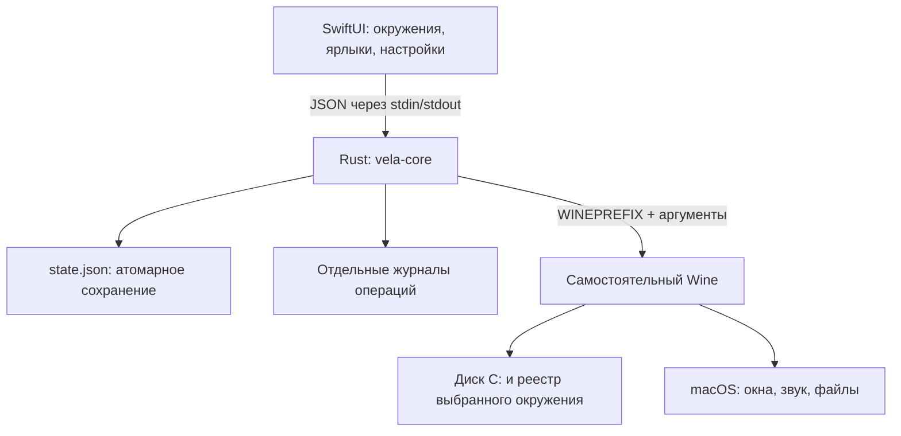

# Wine и архитектура Vela

Техническая справка на 23 октября 2026 года. Описанные планы отделены от реализованного кода.

## Как работает Wine

Windows-программа загружается как PE-файл. Она вызывает Windows API: функции работы
с окнами, файлами, реестром, сетью и звуком. Wine предоставляет собственную реализацию
этих функций и связывает их с возможностями Unix/macOS.

Это не установка Windows. При этом Wine — гораздо больше, чем перенаправление
вызовов один к одному: нужно воспроизводить Windows ABI, загрузку DLL, COM, исключения,
синхронизацию, семантику файлов и поведение множества API.

Основные части исходного проекта:

| Часть | Задача |
| --- | --- |
| `loader/` и загрузочные компоненты | Подготовка процесса и запуск Windows-кода |
| `dlls/ntdll`, `kernel32`, `kernelbase` | Базовые интерфейсы Windows, процессы, память и файлы |
| `dlls/user32`, `win32u`, `winemac.drv` | Окна, ввод и интеграция с графической системой macOS |
| `server/` — wineserver | Координация объектов и состояний, общих между процессами Wine |
| `programs/` | wineboot, winecfg, regedit, cmd и другие инструменты |
| Драйверы звука, сети и графики | Доступ к соответствующим возможностям хоста |

Первоисточник: [Wine README и дерево исходников](https://github.com/wine-mirror/wine).
Официальный Git находится на [WineHQ GitLab](https://gitlab.winehq.org/wine/wine).

## Wine и процессор — разные задачи

Wine реализует интерфейсы Windows. Выполнение инструкций Intel на Apple Silicon —
отдельная задача. Старый движок Gcenx x86_64 запускается через Rosetta.
В нативном варианте Wine и wineserver работают как ARM64, а FEX внутри Wine
переводит x86_64-инструкции Windows-программы в ARM64. Оболочка SwiftUI и Rust-ядро
также нативные. Замена только интерфейса не устраняет зависимость Intel Wine от Rosetta.

Для Vela 0.2 подготовлена отдельная сборка Wine 11.18 с ARM64EC и FEX под macOS 26.5.
Исходники закреплены в [native-runtime-sources.json](native-runtime-sources.json).
Готовый Wine loader поставщика имел минимум macOS 27, поэтому Wine и Unix-модули FEX
пересобраны локально с deployment target 26.5. PE-модули FEX взяты из проверенного
архива; патчи сверены с точным исходным коммитом его сборки.

Этот вариант использует KUSER_SHARED_DATA выше 4 ГБ и обычное локально подписываемое
разрешение custom-x18-abi-toggle. Он рассчитан на 64-битные Windows-программы.
Для полного 32-битного режима на этой архитектуре нужна другая сборка с ограниченным
разрешением Apple на нижние адреса памяти. Такого профиля на устройстве нет.
SIP, AMFI и проверки сертификатов не отключались.

ARM64/FEX пока требует проверки конкретных приложений. Устранение зависимости от
Rosetta не гарантирует совместимость любого Windows-ПО и всех будущих macOS.

Первоисточники: [исходники Hadron](https://github.com/Broyojo/hadron),
[FEX](https://github.com/FEX-Emu/FEX),
[описание Rosetta от Apple](https://support.apple.com/en-us/102527).

WoW64 позволяет поддерживать 32-битные Windows-программы в соответствующей
64-битной сборке Wine. На современной macOS нельзя просто собрать старый
32-битный Unix Wine и ожидать работы. Проверяйте возможности конкретного движка.

## Что такое окружение / bottle / prefix

Это папка, указанная в `WINEPREFIX`. В ней находятся:

- `drive_c/` — дерево Windows-файлов;
- `system.reg`, `user.reg`, `userdef.reg` — реестр;
- `dosdevices/` — сопоставления дисков, включая связи с файловой системой Mac;
- установленные приложения, библиотеки, пользовательские данные и настройки.

Окружения удобны, чтобы несовместимые зависимости не мешали друг другу.
Это разделение настроек, а не граница безопасности. По умолчанию Wine может
показывать файловую систему хоста через Windows-диски.

Обновление Wine иногда обновляет и содержимое префикса. Возврат к старому
бинарнику не обязательно возвращает старое состояние префикса. Перед сменой
движка необходима копия/снимок после остановки всех Wine-процессов.
В Vela 0.5 смена движка доступна в настройках окружения: остановка Wine, копия префикса и метаданных, wineboot --update, проверка запуска и сохранение выбранного движка. При ошибке выполняется попытка отката. Состояние прерванной операции сохраняется; до восстановления запуск блокируется. Файлы после переключения при откате сохраняются отдельно в папке копии.

## Графика

| Вариант | Цепочка | Практический смысл |
| --- | --- | --- |
| WineD3D | Direct3D → графический backend Wine | Набор возможностей зависит от сборки |
| DXMT | Direct3D 10/11 → Metal | Открытый путь к Metal на macOS |
| DXVK + MoltenVK | Direct3D → Vulkan → Metal | Нужны совместимые версии и доступные расширения Vulkan |
| D3DMetal | Direct3D → Metal, компонент Apple | Отдельные условия использования; не компонент полностью открытого дистрибутива |

Текущий DXVK ориентирован на Linux/Wine; наличие проекта само по себе не означает,
что любая его версия будет работать через MoltenVK на macOS. Для DX12 также нельзя
просто подставить Linux Proton/vkd3d-proton и гарантировать аналогичный результат.

Первоисточники: [DXMT](https://github.com/3Shain/dxmt),
[DXVK](https://github.com/doitsujin/dxvk),
[MoltenVK](https://github.com/KhronosGroup/MoltenVK),
[Apple Game Porting Toolkit](https://developer.apple.com/games/game-porting-toolkit/).

Vela 0.2 не устанавливает эти backends и не переключает их автоматически.
Ручной DLL override не устанавливает отсутствующую DLL.

## Откуда приходят обновления

Есть несколько независимых потоков:

1. **Wine upstream.** Участники открытого сообщества отправляют изменения
   в WineHQ. Из исходников формируются стабильные и development-релизы. Сам Wine
   не является единым магазином macOS-бинарников с автоматическим обновлением.
2. **Wine Staging.** Набор экспериментальных патчей поверх соответствующей версии
   upstream, а не другой интерфейс. Функция может позже попасть в основной Wine.
3. **Сборщик для macOS.** Например, Gcenx собирает Wine с зависимостями и macOS-патчами,
   публикует готовые архивы. Это отдельный поставщик бинарников. Их версии могут
   отставать от исходников WineHQ.
4. **Графические библиотеки и зависимости.** DXMT, DXVK, MoltenVK, Mono/Gecko и другие
   компоненты обновляются в собственных проектах. Совместимые комбинации проверяются
   при сборке движка.
5. **Наша оболочка и профили.** UI, менеджер окружений и сценарии совместимости
   должны иметь собственные открытые релизы независимо от Wine.

На момент проверки upstream объявляет [Wine 11.20](https://github.com/wine-mirror/wine/blob/master/ANNOUNCE.md),
а последний опубликованный релиз в проверенном канале
[Gcenx macOS_Wine_builds — 11.18](https://github.com/Gcenx/macOS_Wine_builds/releases/tag/11.18).
Поэтому «последний Wine» и «последний готовый macOS Wine» — разные значения.
Эти номера актуальны на указанную дату, а не закреплены как вечный latest.

[Описание Wine Staging](https://github.com/wine-staging/wine-staging).

## Реализованная архитектура Vela

SwiftUI запускает короткоживущий процесс `vela-core` вне главного UI-потока.
Один запрос — одна строка компактного JSON, ответ — одна строка JSON.
Интерфейс ограничивает ожидание ответа: 180 секунд для инициализации,
30 секунд для остальных операций. JSON-протокол проще проверить, версионировать и диагностировать, чем общий
FFI с владением памятью. Для этой оболочки стоимость запуска процесса мала
по сравнению с запуском Windows-программы. Постоянного фонового сервиса нет.

Rust отвечает за:

- проверку движка через `wine --version` и поиск соответствующего wineserver;
- инициализацию `wine wineboot --init`;
- явные `WINEPREFIX` и `WINEARCH=win64`;
- запуск процесса без macOS shell, с массивом аргументов и выбранным cwd;
- `msiexec /i` для MSI;
- запрет подмены переменных, которыми задаются путь окружения и движка;
- сериализацию записей, временный файл, fsync и rename для state.json;
- файлы логов вместо pipe для долгоживущих Windows-процессов;
- остановку только выбранного префикса через `wineserver -k`.

После передачи запуска ядро выходит. GUI не утверждает, что приложение успешно
загрузилось: статус «окружение готово» означает успешный wineboot. Отслеживание
жизненного цикла дерева Wine-процессов пока не реализовано.

Пользовательские окружения не преобразуются автоматически при добавлении движка.

## Предлагаемая схема обновлений Vela, ещё не реализована

- Наш репозиторий содержит release-манифест: версия Wine, архитектура, минимальная
  macOS, URL архива, размер, SHA-256, перечень компонентов, точные исходники и патчи.
- Манифест подписывается; ключ проверки встроен в приложение. Одного SHA-256 из
  того же неподписанного канала недостаточно для подтверждения издателя.
- Архив скачивается во временную папку. Перед распаковкой проверяются подпись,
  размер и хеш. Распаковка запрещает выход путей за целевой каталог и опасные ссылки.
- Версии устанавливаются рядом. Движок не заменяется под работающим процессом.
- При смене движка останавливаем окружение, создаём снимок, выполняем обновление,
  проверяем запуск. Откат возвращает и движок, и снимок префикса.
- UI можно обновлять через Sparkle с собственным каналом. Движки и профили остаются
  отдельными версиями. Автоматические проверки делаются опциональными.

Документация [Sparkle](https://sparkle-project.org/documentation/).

## Открытый код и распространение

Наш код написан заново и распространяется под MIT. Wine —
[LGPL 2.1 или более поздняя версия](https://github.com/wine-mirror/wine/blob/master/LICENSE).
Изменённый Wine можно использовать в открытом проекте с соблюдением его условий.
При распространении движка нужно сохранять уведомления и обеспечивать доступ
к соответствующим исходникам, включая собственные патчи и необходимые материалы
сборки. Упакованные зависимости имеют свои лицензии.

Основа Vela — публичные интерфейсы Wine и собственный код менеджера.
